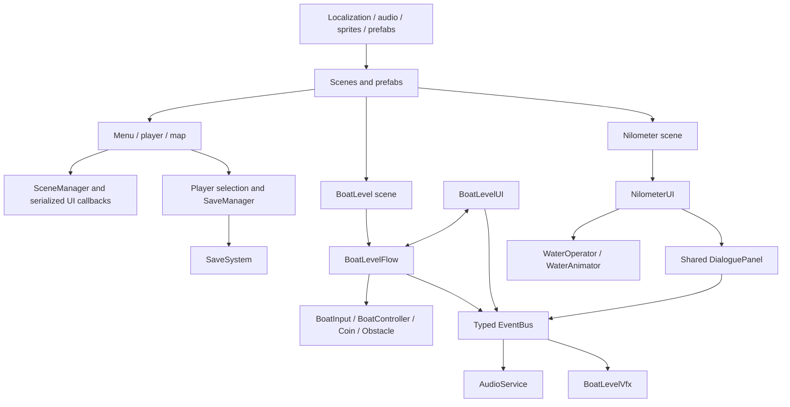

# System architecture and connections

## Architecture at a glance

The game is a scene-composed Unity application. Scene YAML and prefabs provide GameObjects, component references, UnityEvent bindings, art, and UI. Runtime code has a newer namespaced boat module alongside older global-namespace scene systems.

This diagram combines code references and serialized scene composition. It does not claim every scene shares one persistent service instance.

## Ownership and communication

| System | Owns / changes | Trigger and inputs | Outputs / communication | Completion / cleanup |
| --- | --- | --- | --- | --- |
| `BoatLevelFlow` | `LevelState`, stars, coins, distance progress, docking. | UI calls (`CompleteIntro`, `StartPlaying`, help/settings/arrival); boat callbacks; frame updates. | `LevelStateChangedEvent`, `LevelProgressEvent`, `CoinCollectedEvent`, `BoatHitObstacleEvent`, `PlaySfxEvent`; direct calls into boat/input. | Sets Complete after arrival dialogue; replay reloads active build index; next loads serialized name. `OnDisable` unhooks callbacks and restores time scale. |
| `BoatInput` | Pointer tracking and enabled/disabled input state. | Keyboard and pointer devices via Input System; checks EventSystem raycasts. | `OnLaneStep(-1/+1)` C# event. | Clears pointer tracking when disabled. |
| Namespaced `BoatController` | Lane, movement, speed, blocked state, collision feedback, autopilot. | Lane steps and physics trigger contacts; progress from flow. | C# obstacle/coin callbacks to flow; `PlaySfxEvent`; `BoatBlockedEvent`. | Stops/autopilots at dock; uses Rigidbody2D movement. |
| `BoatLevelUI` | Screen visibility and HUD rendering. | Button handlers and typed events. | Calls level-flow methods directly; publishes tap SFX event. | Removes listeners/subscriptions in lifecycle cleanup. |
| `AudioService` | Audio source playback, fades, volume, snapshots, voice ducking. | Typed SFX/voice/state/settings/pause events. | `VoiceActivityEvent` to expressions. | Unsubscribes in `OnDisable`; fades use unscaled delta time. |
| `BoatLevelVfx` | Visual particle/camera feedback. | Coin, impact, and level-state events. | Particle, camera shake, celebration animation. | Removes event subscriptions in `OnDisable`. |
| `NilometerUI` | Quiz acceptance, active level/attempts, stars, pending dialogue, lesson/completion visibility. | Dialogue callbacks, water-level event, answer/hint button events. | Calls `WaterOperator`; publishes SFX; invokes serialized UnityEvents. | Removes listeners and callbacks on destroy/disable. |
| `WaterOperator` | Ordered serialized level definitions and current level index. | `MoveToLevel`, `MoveToNextLevel`; animation completion. | Raises `WaterLevelReached` UnityEvent-like C# event with index and target. | Stops/guards overlapping level animations. |
| `SaveManager` | Active player and loaded player data. | Player registration, scene/player selection UI, explicit save/load calls. | Calls static `SaveSystem`; invokes serialized `OnLoadedData`. | Persistent singleton behavior is implemented with `DontDestroyOnLoad`. |

## Direct and indirect dependencies

- **Direct compile-time calls:** `BoatLevelFlow` calls methods on its serialized boat, input, and camera references; `NilometerUI` calls `WaterOperator` and dialogue methods; `SaveManager` calls `SaveSystem`.
- **Serialized runtime references:** `[SerializeField]` fields in scene components connect scene objects, buttons, dialogue panels, audio sources, mixer snapshots, water levels, and visual assets. These are not visible from C# alone; scene YAML supplies some evidence.
- **Event-driven dependencies:** `EventBus` statically routes value-type event structs. It is synchronous and transient; late subscribers do not receive old events.
- **UnityEvent dependencies:** `WaterOperator.WaterLevelReachedEvent`, answer/completion callbacks, hover callbacks, scene organizer callbacks, and UI button events can invoke targets serialized in scenes. Code inspection alone cannot establish all target bindings.
- **Singleton/global access:** `SaveManager`, legacy `SoundManager`, `SceneManager`, and `PlayerManager` expose singleton patterns. These introduce global runtime dependencies and duplicate-instance considerations.
- **Runtime loading:** `SceneManager` calls Unity SceneManager load APIs; `spawning` instantiates a selected prefab. No project-owned Addressables or Resources load call was found.

## EventBus behavior

`BoatGame.CoreData.Messaging.EventBus` provides a generic static channel per event struct. It avoids a central event dictionary and supports removing a listener during a publish by deferring compaction. Listeners added during a publish run on the next publish. Exceptions from callbacks are not isolated by the bus; an exception can propagate through the publisher. Subscribers should pair `Subscribe`/`Unsubscribe` in `OnEnable`/`OnDisable`.

## Architecture boundaries and coupling

- The namespaced boat system is event-oriented for UI/audio/VFX but retains direct C# callbacks from boat/input actors to `BoatLevelFlow`.
- `BoatLevelUI` reaches flow through `Service<BoatLevelFlow>`, a scene component resolver/cached reference, and also uses typed events for presentation updates.
- Nilometer is more directly coordinated: `NilometerUI` owns the quiz/dialogue flow and calls water/dialogue/character components directly.
- Audio has two parallel systems. `AudioService` consumes the typed event bus; `SoundManager` is a legacy key-based singleton. Their coexistence can create scene-specific differences.
- Global class names collide: two `BoatController` classes and two `DialoguePanel` classes exist. `PlayerSelector.cs` and `PlayerUISelector.cs` also contain class names opposite their filenames. Preserve exact type and scene binding during maintenance.
- Static references and scene-level singletons are not a demonstrated circular dependency. A cycle was not established from inspected code.

## Initialization and lifecycle considerations

Unity does not guarantee ordering among unrelated objects' `Awake`/`Start` methods unless script execution order or explicit coordination is configured. `NilometerUI.Start` deliberately yields one frame before reading avatar selection, implying a dependency on `PlayerAvatarSelector.Start`. `BoatLevelFlow.Start` publishes an initial state event; an active listener is needed at that moment to receive it. Verify scene object enablement and script order in Unity when changing initialization behavior.

See [event flow](diagrams/script-dependencies.mmd), [script reference](03-Script-Reference.md), and [scene reference](05-Scenes-and-Transitions.md).
