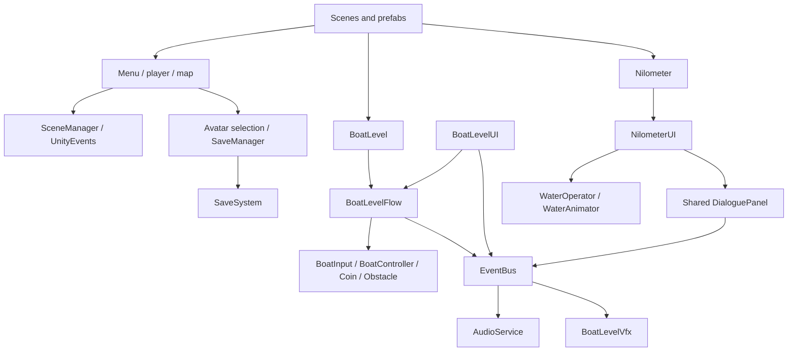
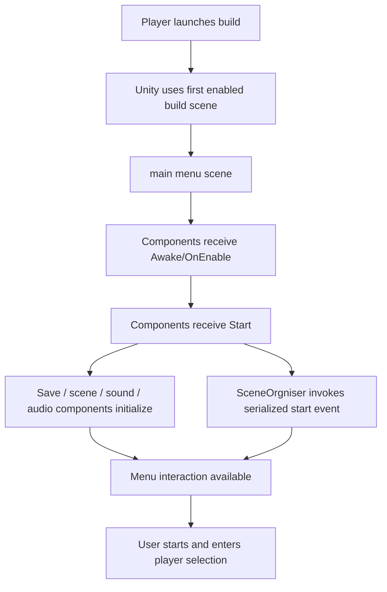
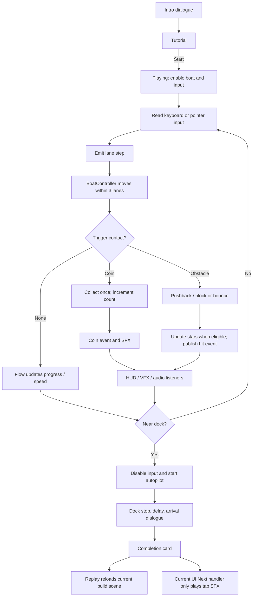
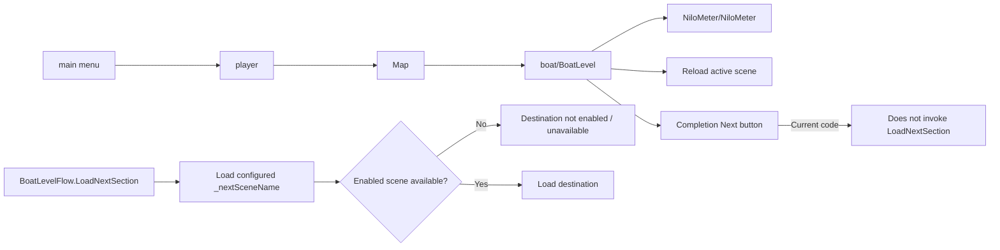
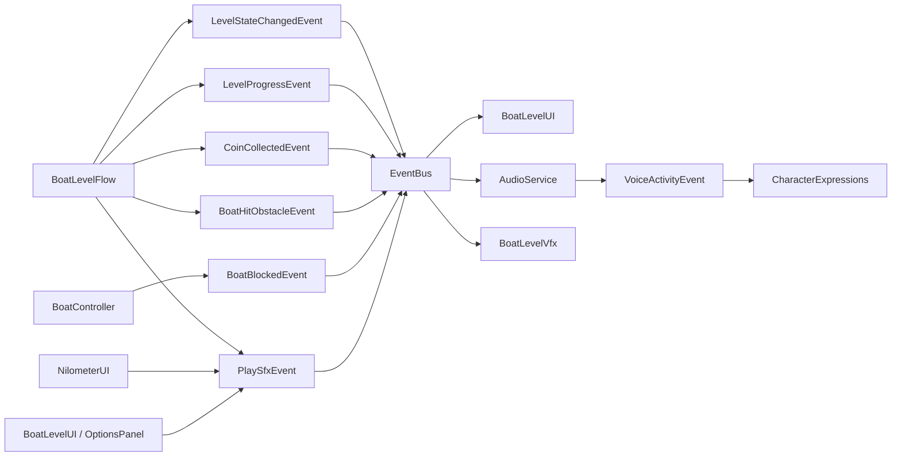
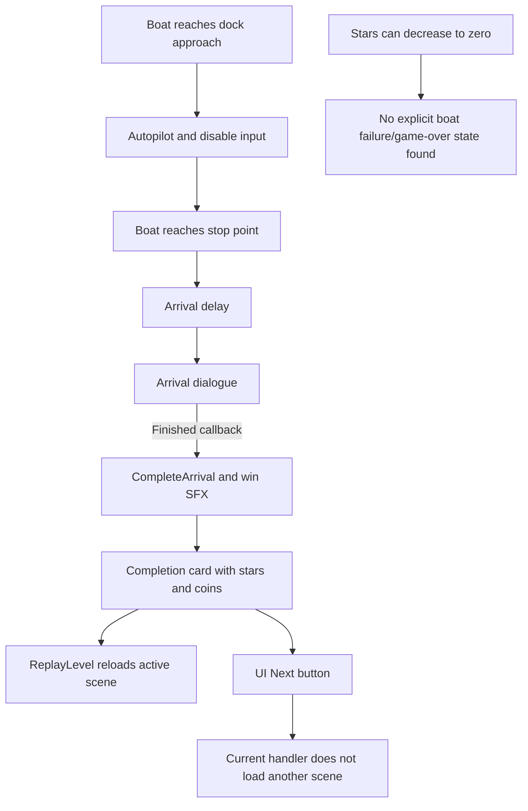

# Editable flowcharts

The diagrams below use Mermaid source and have standalone editable `.mmd` files in `Documentation/diagrams/`. They describe source/configuration paths, not play-tested runtime traces.

## A. Project overview

Shows which systems are directly coordinated and which exchange typed events. Based on code references and scene composition.

Source: [project-overview.mmd](diagrams/project-overview.mmd).

## B. Startup and initialization

Shows first enabled scene and known main-menu components. Ordering among unrelated Unity callbacks remains inferred because no runtime trace was collected.

The callback order between objects and the effect of the serialized organizer event depend on Unity scheduling and scene wiring. Source: [startup-flow.mmd](diagrams/startup-flow.mmd).

## C. Main gameplay loop — boat level

Source: [gameplay-flow.mmd](diagrams/gameplay-flow.mmd). No fail state is shown because none was identified in this state machine.

## D. Scene transitions

The exact menu/map button edges rely on serialized UnityEvents and should be verified in the scene. Source: [scene-transitions.mmd](diagrams/scene-transitions.mmd).

## E. Typed gameplay event flow

Bus publishing is synchronous; only active subscriptions receive a publish. Source: [system-architecture.mmd](diagrams/system-architecture.mmd).

## F. Victory, failure, and restart

The Nilometer separately completes after lesson/cubit dialogue and displays remaining stars. No explicit failure screen/state was identified in either flow. Source: [gameplay-flow.mmd](diagrams/gameplay-flow.mmd).

## Additional learning and persistence flows

The detailed Nilometer quiz/water flow and save/load envelope sequence are included in the standalone [sequence-diagrams.mmd](diagrams/sequence-diagrams.mmd); the save/load static flow is also in [class-diagram.mmd](diagrams/class-diagram.mmd) where data ownership is summarized. These additional sources are linked from [UML diagrams](10-UML-Diagrams.md).
