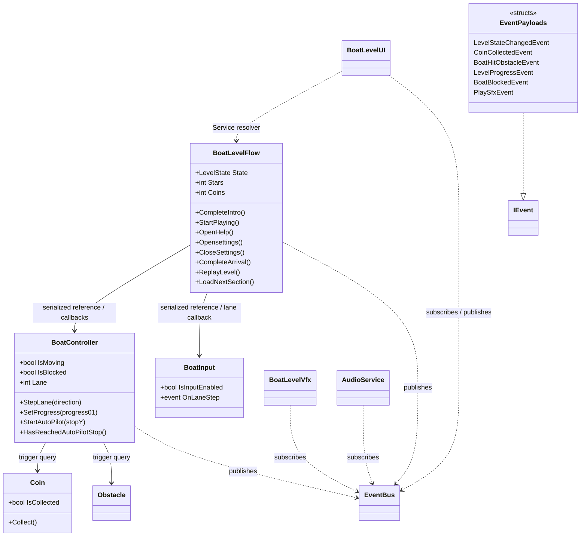
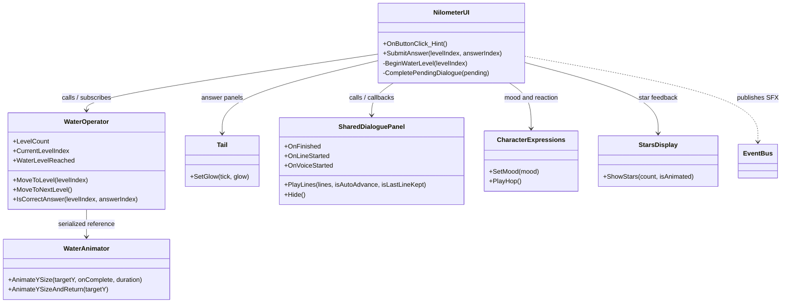
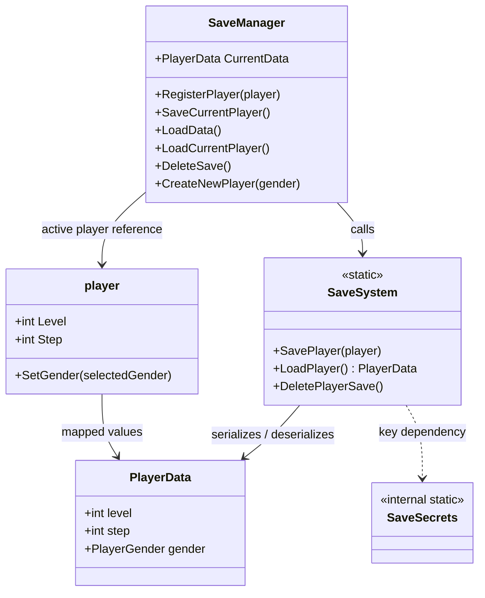
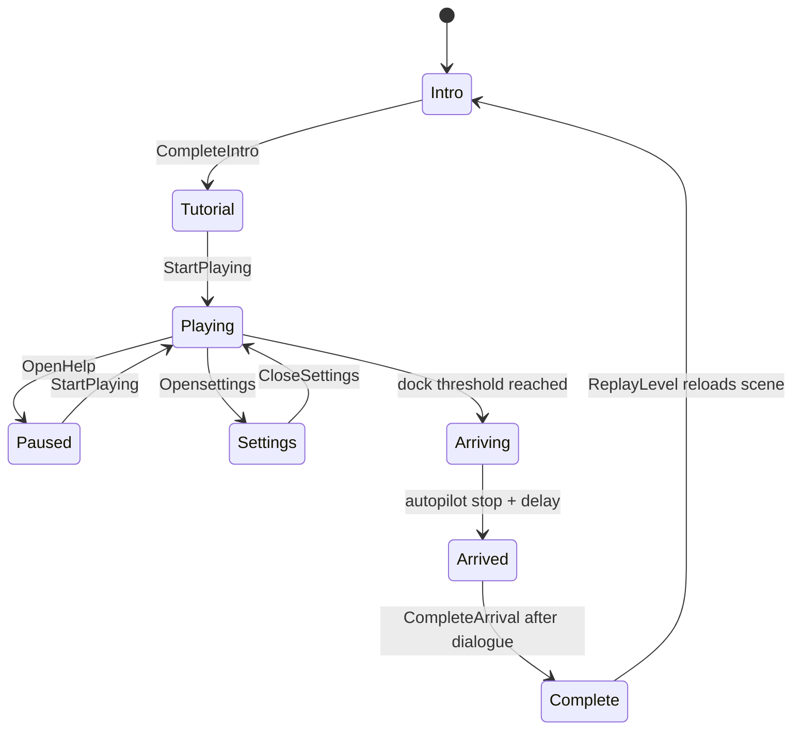
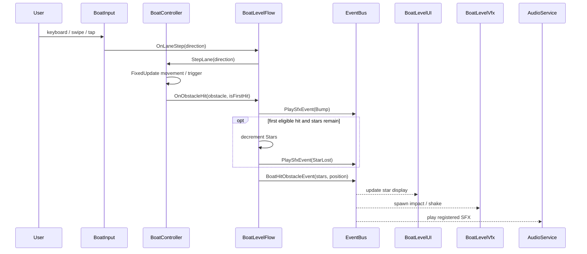
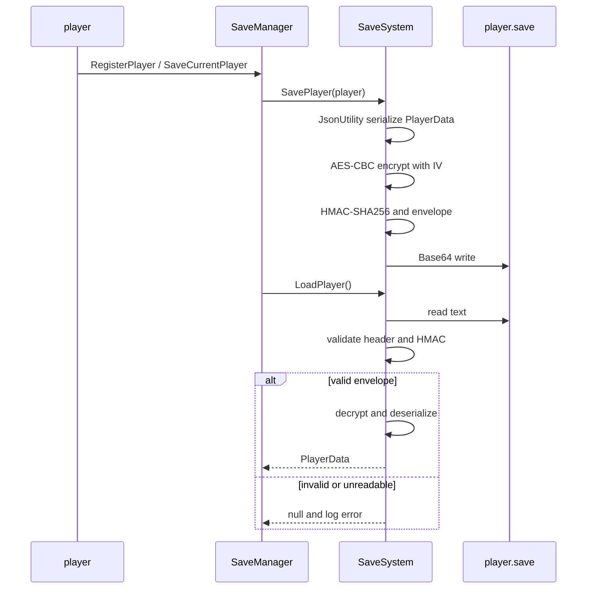

# UML-style diagrams

The Mermaid diagrams below use code-supported relationships. A serialized field reference is shown as an association/dependency, not composition, unless object lifetime ownership is explicit in code. Diagrams are intentionally limited to system slices rather than every imported class.

## 1. Boat system class diagram

Shows the coordinator, input/controller delegates, events, and consumers. It does not show all private tuning fields or every visual helper.



Purpose: document ownership and communication for the namespaced boat feature. `BoatController` invokes flow callbacks; UI/audio/VFX use events. Source: `Assets/scripts/GameplaySystems/BoatLevel/` and `CoreData/BoatLevelEvents.cs`.

## 2. Nilometer class diagram



Purpose: show that the UI coordinates quiz state while `WaterOperator` owns stage rules and water animation. A `Tail` panel/button binding is serialized; exact per-button wiring should be verified in the scene.

## 3. Persistence class diagram



Purpose: clarify player/session ownership versus file serialization. The actual save payload includes the fields serialized by `PlayerData`; this diagram omits secret contents.

## 4. Boat state diagram



`Lesson` is present in the `LevelState` enum but is not entered by the current `BoatLevelFlow` path. No failure state is defined in this state machine.

## 5. Sequence diagram — boat obstacle hit



The sequence follows direct C# callbacks and typed subscriptions in the source. Physics timing and scene listener activation were not runtime-tested.

## 6. Sequence diagram — Nilometer answer

```mermaid
sequenceDiagram
    participant User
    participant Tail as Question button
    participant UI as NilometerUI
    participant Water as WaterOperator
    participant Dialogue as Shared DialoguePanel
    participant Bus as EventBus
    User->>Tail: select answer
    Tail->>UI: SubmitAnswer(levelIndex, answerIndex)
    UI->>Water: IsCorrectAnswer(levelIndex, answerIndex)
    alt correct
        UI->>Bus: PlaySfxEvent(Correct)
        UI->>UI: feedback animation and dialogue progression
    else incorrect
        UI->>UI: decrement stars / increment attempts / disable answer
        UI->>Bus: PlaySfxEvent(Wrong)
        alt first miss
            UI->>Dialogue: play almost line
            Dialogue-->>UI: finished callback; resume question
        else second miss
            UI->>Dialogue: play sorry line
            Dialogue-->>UI: finished callback; next level or lesson
        end
    end
```

The selected answer index is serialized into button events and validated against current WaterLevel data.

## 7. Sequence diagram — save/load



## Diagram limits

Mermaid class diagrams cannot show Unity serialized object identity or scene activation states. Diagram lines represent code-level dependencies, callbacks, or serialized references as labeled. `Composition` is not used unless lifetime ownership is proven.
