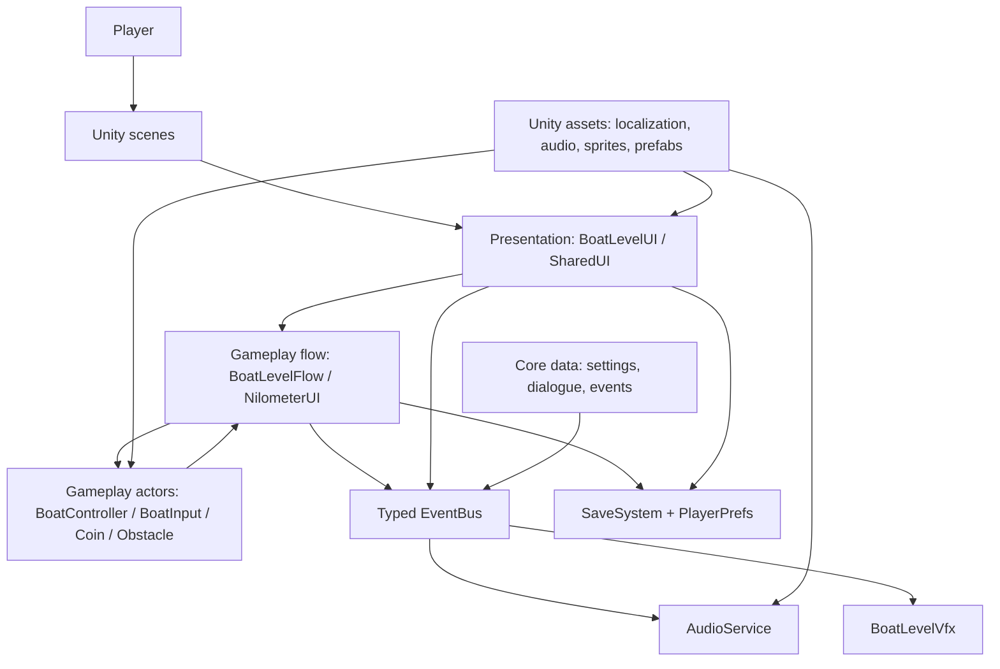

# Architecture

## System overview

The standalone source is [system-overview.mmd](diagrams/system-overview.mmd).

## Runtime layers

| Layer | Main code | Responsibility |
| --- | --- | --- |
| Scene composition | `Assets/Scenes` | Game objects, serialized references, UI, physics, and transitions. |
| Presentation | `Assets/scripts/Presentation` | HUDs, dialogue, options, character poses, and Nilometer feedback. |
| Gameplay | `Assets/scripts/GameplaySystems/BoatLevel` | Boat movement, input, collisions, collectables, camera, and level state. |
| Core data/messaging | `Assets/scripts/CoreData` | State, audio IDs, dialogue, settings, typed events, and service lookup. |
| Cross-cutting services | Audio, save, localization scripts | Implements audio, persistence, and language selection. |
| Content/plugins | `Assets/Exloris`, `Assets/Plugins`, imported folders | Localization tables, art, audio, DOTween, RTL support, and packages. |

## Boat level boundary

`BoatLevelFlow` coordinates the boat session: it owns state, stars, coins, start/arrival rules, and scene navigation. `BoatController` owns movement and collision detection, while `BoatInput` converts player input into lane requests. UI, VFX, and audio consume typed events instead of holding references to every gameplay actor.

`Service<T>` lazily finds and caches a scene component such as `BoatLevelFlow`. Use it as a narrow scene-level bridge, not as a general application dependency container.

## Event communication

`BoatGame.CoreData.Messaging.EventBus` has one static, synchronous channel per value-type event. It supports subscribing and unsubscribing during a publish, but it does not queue, persist, replay, or cross scene boundaries.

- Gameplay and flow publish level, progress, obstacle, coin, SFX, and voice events.
- `BoatLevelUI` updates HUD/screen visibility.
- `AudioService` plays SFX and voice, controls mixer values, ducks music, and switches snapshots.
- `BoatLevelVfx` emits shared particle effects and shakes the camera.
- `CharacterExpressions` consumes voice activity to select talking frames.

See [events and data](events-and-data.md) for the full event reference.

## Current architecture notes

This is a project in transition.

- The namespaced `BoatGame.*` boat and presentation areas are the newer feature architecture.
- Older global-namespace scripts remain scene-bound, including player selection, the Nilometer, scene management, and older boat scripts.
- There are two classes named `BoatController` and two dialogue panels. Use fully qualified names or the existing scene binding before changing either area.
- `Assets/Exloris` is a target-oriented folder organization but mostly contains content, folders, and metadata rather than runtime C# code.
- `GameSettings` comments reference `FrameRateSettings`; no matching source was found. Validate display-rate UI integration in Unity.

## Constraints to preserve

1. Keep boat flow state guards when adding transitions.
2. Pauses use `Time.timeScale = 0`; dialogue, fades, and audio that must continue use unscaled/DSP time.
3. Preserve voice-synchronized dialogue typing unless its UX is intentionally redesigned.
4. Keep water movement (`WaterOperator` / `WaterAnimator`) separate from Nilometer learning/feedback (`NilometerUI`).
5. Save files are encrypted and integrity-checked, but the local key requires platform-specific production review.
