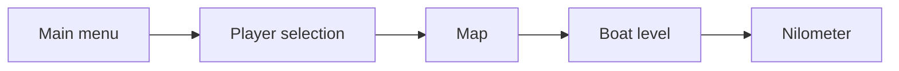
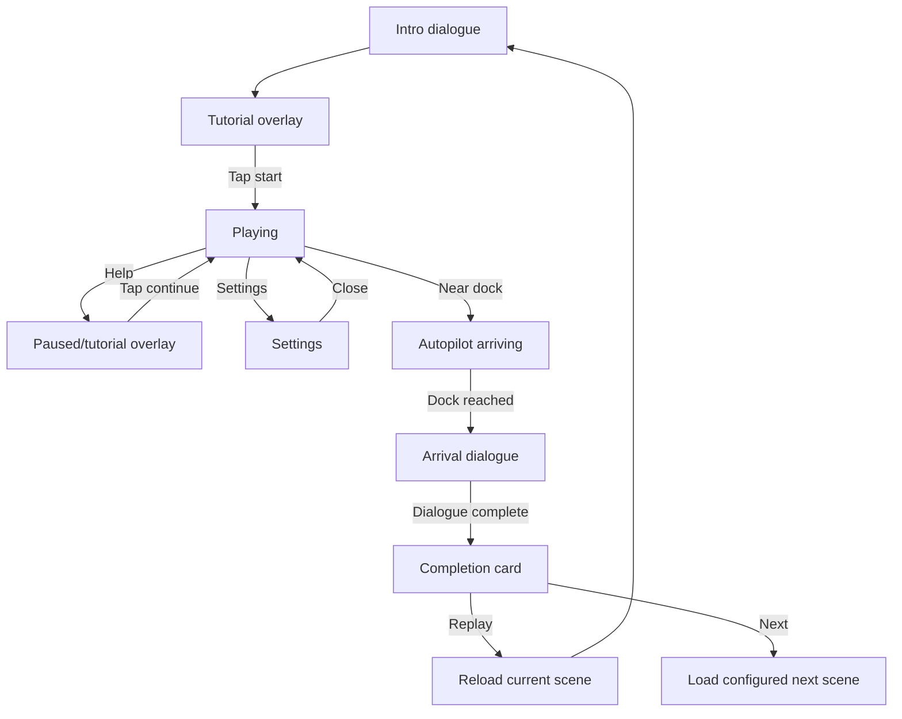
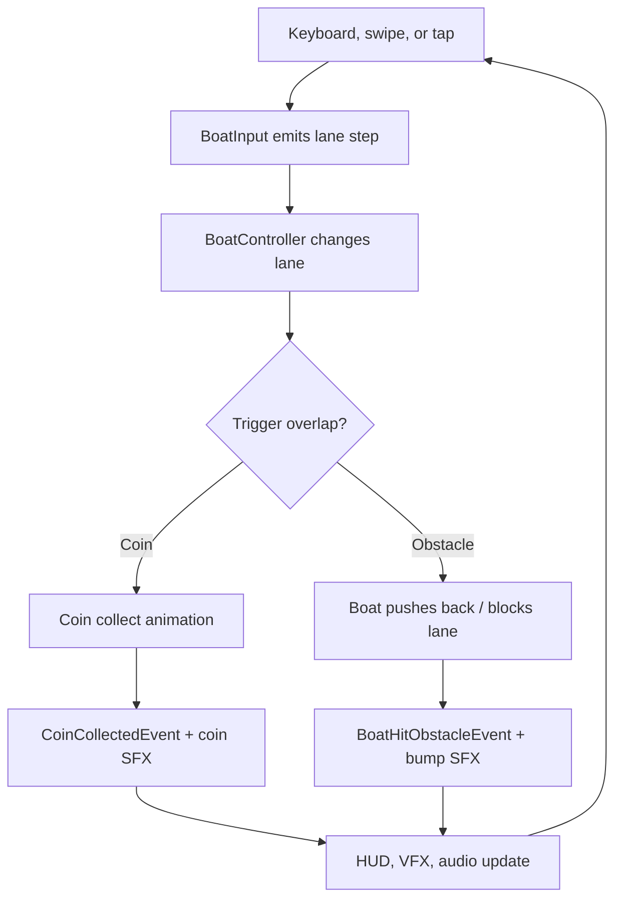
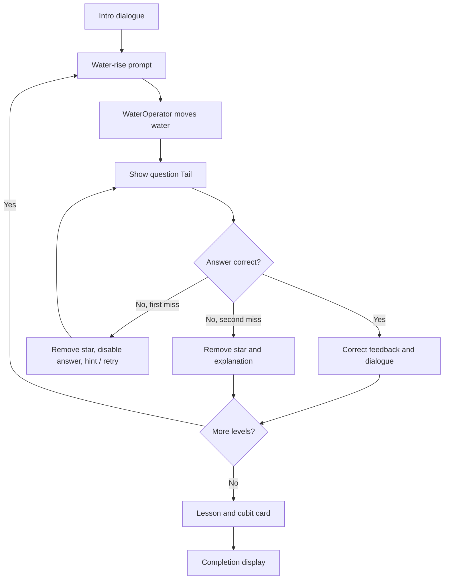
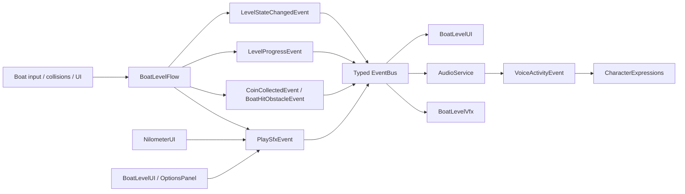
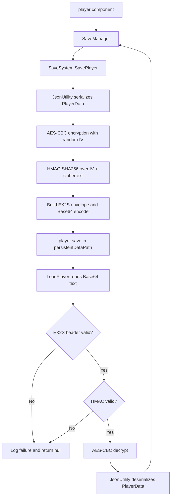
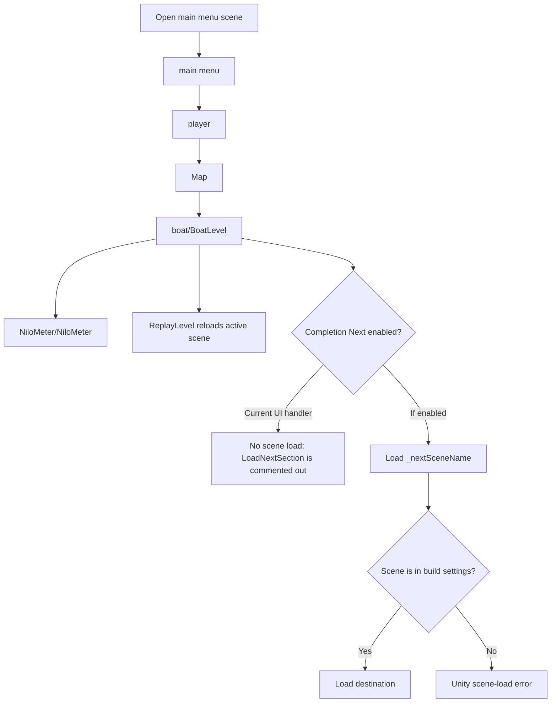

# Gameplay flows

The diagrams are embedded Mermaid source. Standalone scripts live in [docs/diagrams](diagrams/) for Mermaid Live or compatible documentation tools.

## Build scene sequence

This is the enabled scene sequence, not a verified navigation graph. Exact buttons and transitions are scene-configured, so test all serialized destinations after modifying scenes.

## Boat-level state flow

## Boat gameplay loop

An obstacle only costs one star for its first eligible hit. A forward collision blocks the current lane until the player changes lane; a sideways collision returns the boat to its previous lane.

## Nilometer learning flow

Each level permits two missed answers before it advances. Correct answers use a temporary highlighted state before the next explanation or level transition.

## Event and feedback pipeline

The `EventBus` is synchronous and transient: it notifies active listeners but does not store or replay state. The standalone source is [event-pipeline.mmd](diagrams/event-pipeline.mmd).

## Save and load flow

The standalone source is [save-load-flow.mmd](diagrams/save-load-flow.mmd). Save data is integrity-checked before decryption; still treat the shipped client-side key as a platform-security concern, not complete anti-tamper protection.

## Scene navigation and completion behavior

The standalone source is [scene-navigation.mmd](diagrams/scene-navigation.mmd). The player route reflects enabled build scenes; the final links between menu/map/boat/Nilometer are scene-configured and should be play-tested after any scene rename or build-list change.
