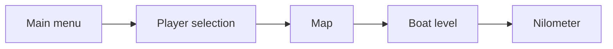
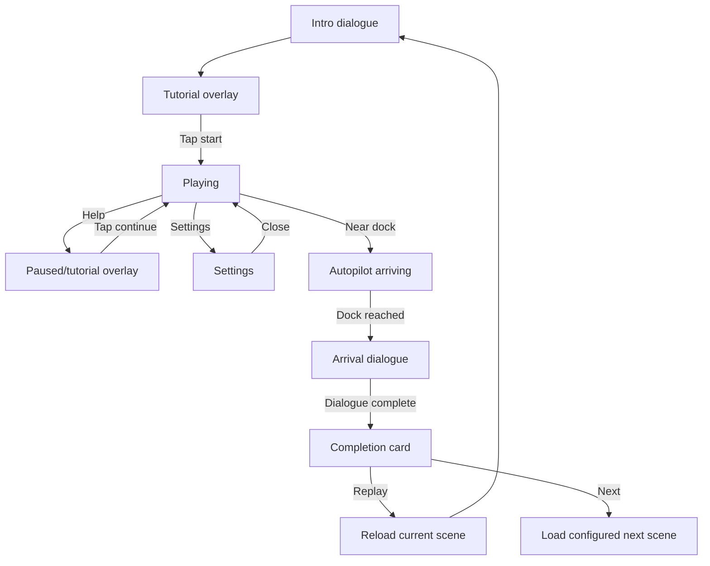
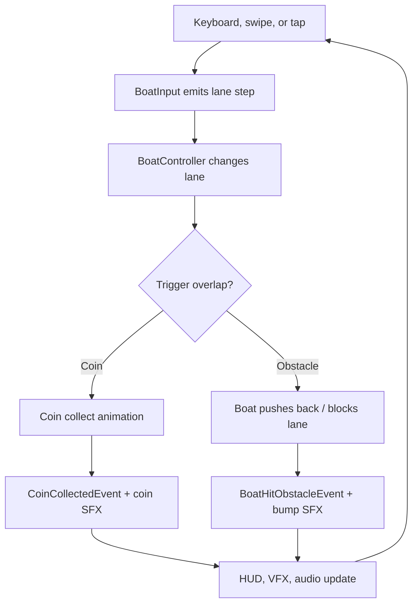
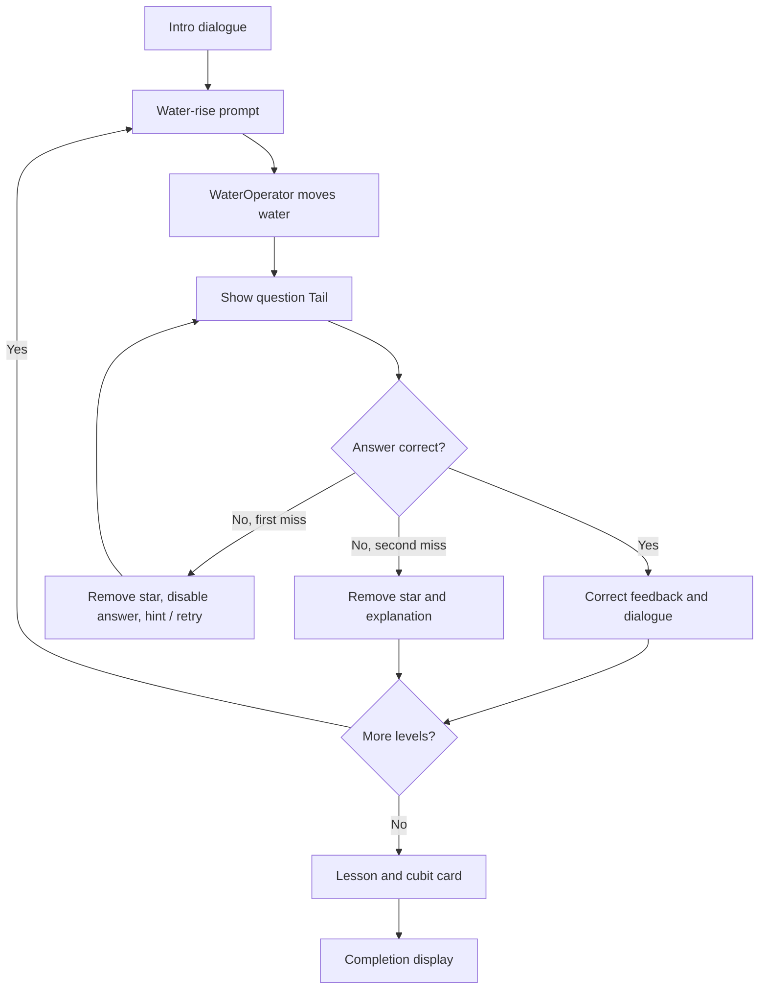

# Gameplay flows

The diagrams are embedded Mermaid source. Standalone scripts live in [docs/diagrams](diagrams/) for Mermaid Live or compatible documentation tools.

## Build scene sequence

This is the enabled scene sequence, not a verified navigation graph. Exact buttons and transitions are scene-configured, so test all serialized destinations after modifying scenes.

## Boat-level state flow

## Boat gameplay loop

An obstacle only costs one star for its first eligible hit. A forward collision blocks the current lane until the player changes lane; a sideways collision returns the boat to its previous lane.

## Nilometer learning flow

Each level permits two missed answers before it advances. Correct answers use a temporary highlighted state before the next explanation or level transition.
